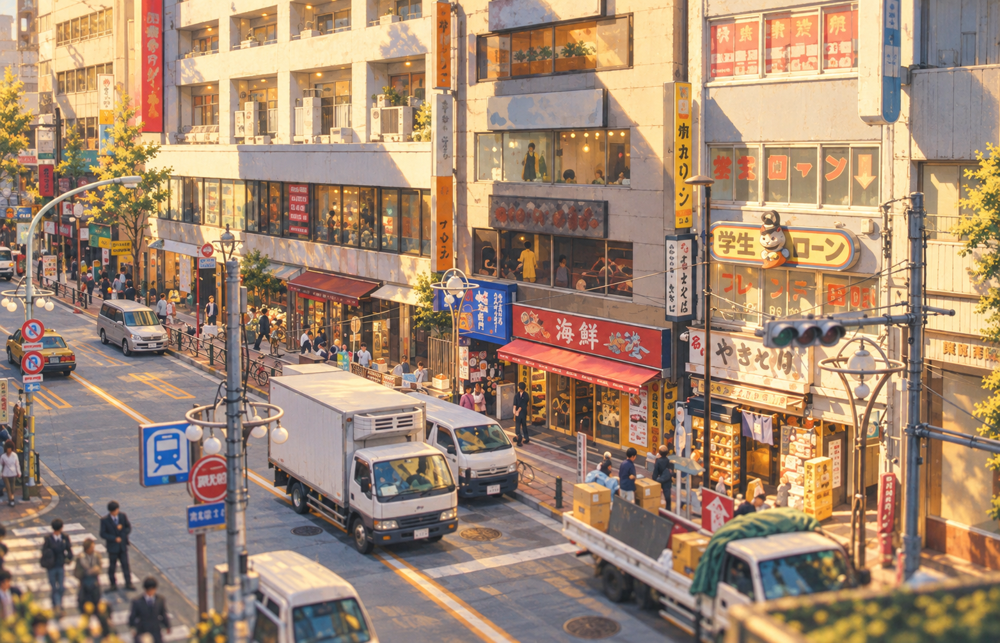
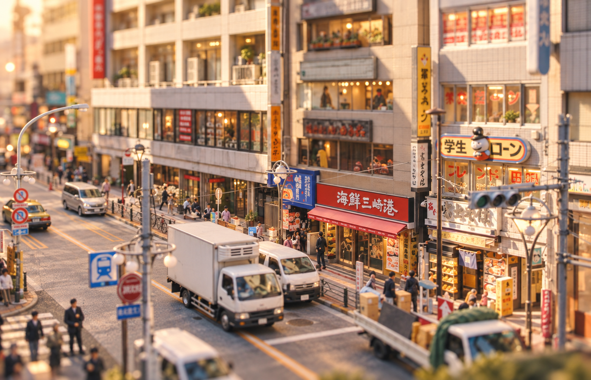
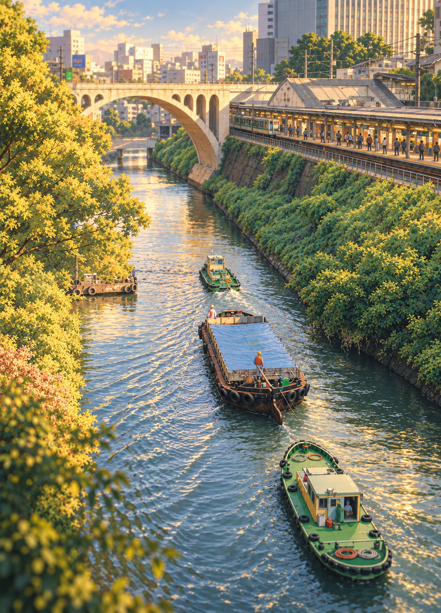
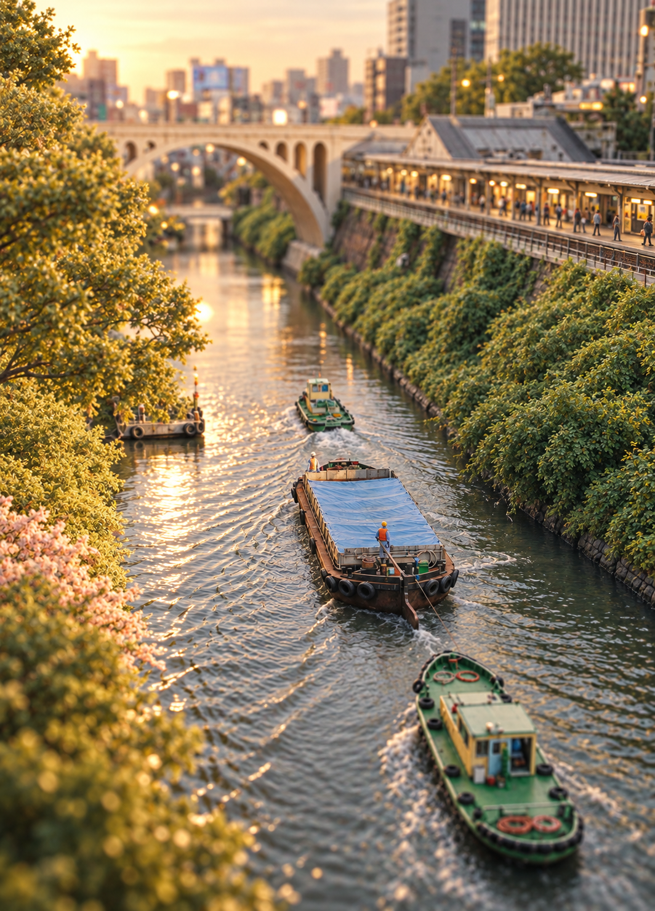
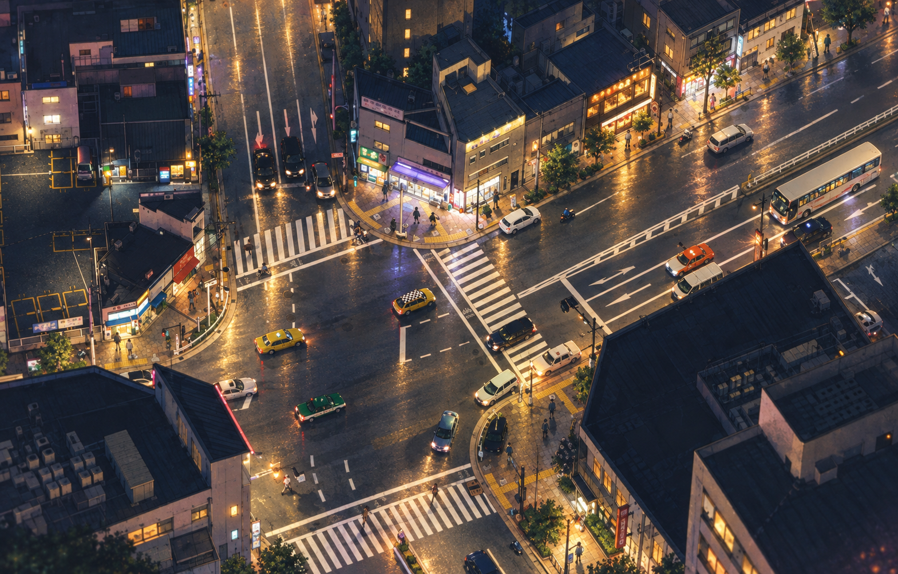
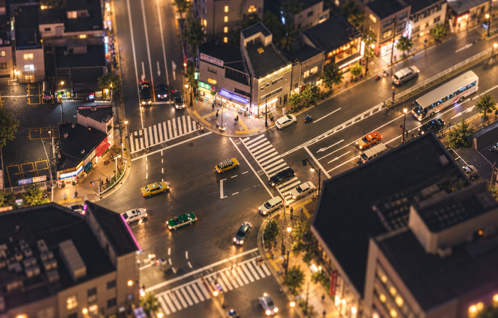
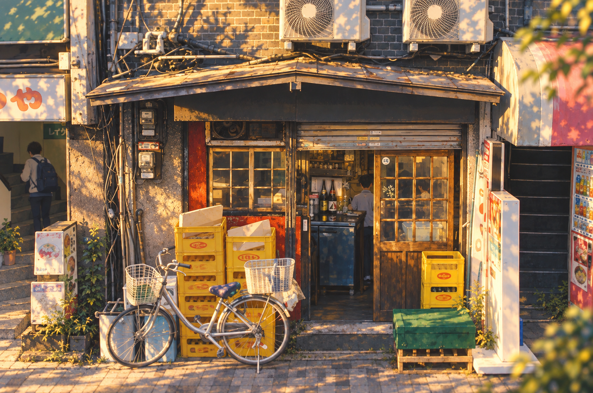
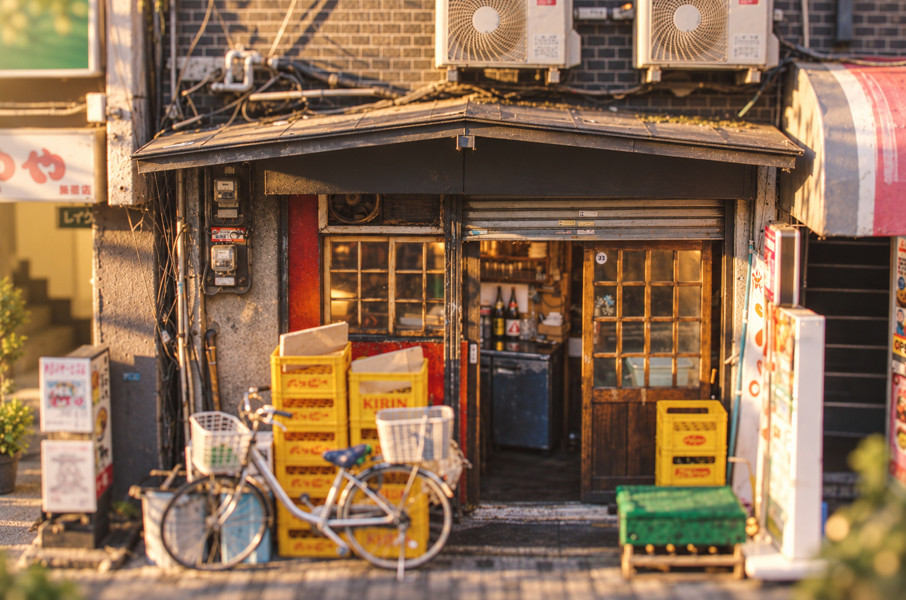

# Everyday city — paired style studies

Added 2026-10-11 from five user-supplied photographs. These supplement the locked [Last Train, First Light](../04-last-train-first-light.png) and [Little Tokyo](../01-little-tokyo.png) concepts; they do not replace them.

The originals are retained unchanged. Photographer, source URL and license were not supplied. Reference use only; do not ship the photographs or these studies as runtime textures. Generated images are art-direction targets, not engine screenshots, measured geometry, or proof of implemented behavior. Generated Japanese lettering is not an approved signage asset.

## Gallery

Each row compares the same subject under the two rendering directions. Open images for full resolution.

| Subject / original | Last Train, First Light | Little Tokyo |
| --- | --- | --- |
| [commercial street](originals/commercial-street.png) |  |  |
| [canal working boats](originals/canal-working-boats.png) |  |  |
| [night intersection](originals/night-intersection.png) |  |  |
| [market deliveries](originals/market-deliveries.png) |  |  |
| [neighborhood shop](originals/neighborhood-shop.png) |  |  |

## What to carry into the living city

- **Commercial street:** tightly spaced facade bays, layered vertical signs, shallow awnings, recessed doors, human-scale sidewalks and delivery activity. Preserve connected pedestrian paths despite visual clutter.
- **Working canal:** directional wakes and reflections, slender boats with different functions, retaining structures partly covered by vegetation, and rail running alongside water. Boat activity should follow coherent routes; the study does not establish that service as implemented.
- **Night intersection:** readable lane and crossing geometry, varied vehicle silhouettes, and localized warm light against quiet dark roofs. Keep asphalt and lane paint reflective according to material and weather; avoid making every surface emissive.
- **Market deliveries:** vehicles occupying purposeful loading bays, clear circulation lanes, repeated truck families with controlled variation, workers and small carts. Density should come from believable arrangement, not indiscriminate clutter.
- **Neighborhood shop:** layered depth at the entrance, timber/glass/metal distinctions, crates, bicycles, cables and utility equipment. Preserve an accessible doorway and use instancing/atlases for repeated details.

## Style and implementation guardrails

Last Train, First Light uses restrained linework, nuanced painted color and atmospheric illumination. Little Tokyo uses convincing miniature materials, natural light and selective lens focus. Both retain the same credible street, vehicle, building and water proportions. Style selection changes presentation, not the simulation's layout or physical connectivity.

Translate references in this order: silhouette and proportions; placement and usable clearances; material and lighting response; readable movement; then fine texture. Compare a fixed camera in both styles and at night. Do not compensate for missing geometry with baked perspective images or excessive blur. Keep detail bounded by visible scale and browser performance; the reference gallery adds no runtime texture loading.

## Generation provenance

Generated with the built-in image generation tool, one call per scene/style pair. [Exact prompts and input paths](prompts.json) identify image 1 as the source composition and image 2 as the locked style board. Originals in this folder provide portable copies of the temporary attachment inputs. Outputs are interpretive and must be checked against the original photographs before adopting construction details.

## Visual review

All ten outputs were inspected. Each pair preserves its source subject and viewpoint, with painted contour/color treatment in Last Train, First Light and stronger optical miniature treatment in Little Tokyo. The canal pair is especially useful for bank layering, water highlights and transport adjacency; the shop pair for material depth and small-scale clutter.

Interpretation caveats: the generated night studies introduce wetter, more reflective asphalt than the original; use that response only for appropriate weather. Several studies add foliage, interior occupants or lighting, and the canal interpretation makes the platform/train detail more explicit. These additions are illustrative rather than source evidence. Fine signage and lane details need authored validation before implementation.
