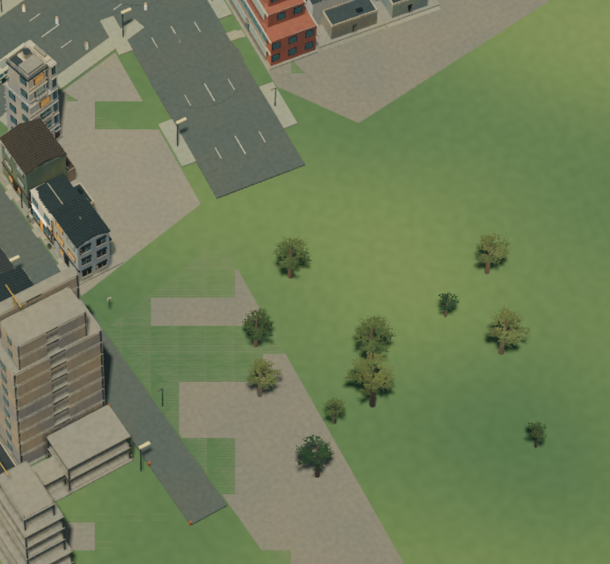

# Ground surface artifacts — 2026-10-11

## Screenshot follow-up — 2026-10-12

The latest supplied attachment is byte-identical to `screenshots/ground-depth/user-artifact.png`
(SHA-256 `46acf7d5194756151a89ecb54136d9013499e30b3291c8d352975f40f88a464b`).
It is retained as the original failing reference, not new evidence that the
current candidate regressed. Track three separate acceptance items: horizontal
depth striping, planting/development overlap, and abrupt road/paving boundaries.
The square road end alone does not prove a broken simulation connection.
Original-camera and continuous-motion verification remain open; earlier sampled
views and the controlled GPU witness do not close that requirement.

Separately, road rebuild staging is currently an unaccepted working-tree
candidate. Focused staged-kit, road-batch, ground-surface and paving tests pass
26/26 and TypeScript passes. Two test setup/assertion mistakes and a callback
narrowing error were corrected; first-use material ordering is now explicitly
preserved and tested across deferred primitives and immediate custom geometry.
These checks establish neither a browser performance improvement nor a repair
of the supplied visual artifact. CPU parity/cost, ordinary growth, style changes,
reset and visible commit latency still need review before promoting staging.

Status: partially addressed. Paved-ground tree clearance and progressive lot
surfacing are implemented and checked in both styles. Depth striping is reproduced in a controlled GPU comparison and the existing
terrain bias removes it there in both backends/styles. Original-city camera,
motion and performance acceptance remain open. The separate WebGPU black-scene
failure has a verified narrow fix; see the later shadow-binding section.

The supplied view shows green horizontal stripes and rectangular/stepped green
patches interrupting paved block surfaces. Trees also protrude through areas
presented as continuous paving, without visible planting openings. The road end
is abruptly square, but the image alone does not establish a disconnected route:
it may be an ordinary unfinished/dead-end segment.

## Evidence and hypothesis

`CityRenderer.buildTerrain` places the main terrain at y=0.
The ground surface builder places developed lot ground at y=.035. `renderBuilding` uses
parcel paving whose top is y=.05. The camera near/far planes are .5/3500 m.
Depth precision between these close surfaces is a plausible cause of striping,
but has not been proven at the supplied camera. Do not call it a texture defect
or a confirmed z-fighting fix without matched reproduction.

At the time of the report, tree clearance in `updateTrees` considered buildings, roads and rear extensions,
but not the full block paving polygons. Meanwhile `masterplan_ground` emits an
entire block after its first parcel releases. This explains why undeveloped land
and trees can appear inside a paved block. Coordinate planting and progressive
ground treatment rather than clearing all greenery indiscriminately.

A fresh ordinary startup at paused day 0, 07:23, Anime, DOF off, Overview
did not visibly reproduce the stripes: [baseline](screenshots/ground-depth/before.png).
This is a different city stage/view, not counterevidence to the supplied defect.
Exact seed, tick and camera for the user image were not supplied.

## Acceptance for the repair

Reproduce the affected stage/camera; retain a current-format checkpoint and
matched before/after captures. Verify grazing and overhead views, zoom motion,
both styles, and WebGPU/WebGL2. Paving must occlude underlying terrain stably
without hiding parcel detail, access paths or road markings. Keep real geometry
heights and simulation access consistent; do not hide the issue with blur.
Tree roots must meet visible soil/planting openings or be cleared only where
actual development requires it. Keep the broad early-block paving issue distinct
from depth artifacts so each change has attributable evidence.

## Terrain depth-bias candidate

A candidate now applies polygon offset (factor 2, units 2) only to the natural
terrain underlay material. Geometry heights, road/paving materials and simulation
state are unchanged. This avoids raising paving through paths or lowering the
ground away from tree roots. It is shared by both styles.

The perspective depth difference for 3.5 cm of vertical separation at an
80%-vertical viewing direction and 1,000 m axial distance is about 1.4e-8 with
the current .5/3500 clipping planes. A CPU float32 calculation maps both depths
to 0.9996427893638611. This demonstrates a precision risk, not the actual GPU
format or a reproduction of the user's view.

Build passes (existing large-bundle warning). Browser candidate checks: seed
87231, tick 1804, day 0 07:48, paused, growth 4x, Overview, 50 mm, DOF off,
High detail, WebGPU. Both styles render intact paving in this view:
[Anime](screenshots/ground-depth/candidate-anime.png),
[Miniature](screenshots/ground-depth/candidate-miniature.png).
[Diagnostics](screenshots/ground-depth/candidate-diagnostics.png) show zero
queued buildings and neighborhood batches through normal scheduling.
The current-format exported checkpoint is retained locally in
`.tools/fidelity-review/ground-depth-candidate.json`.

**Still pending for depth bias:** matched reproduction at the original camera,
WebGL2 and motion comparison. Vegetation clearance was subsequently addressed
below. Before/candidate images
are different stages and viewport sizes; they are not an A/B proof of repair.
Do not mark the user defect resolved or tune additional biases until the
candidate is compared at a reproduced failing view.

## Paved block vegetation clearance

`createPavedGroundTest` now builds per-patch bounds once per tree update and
checks roots against the actual polygon, including its edge. `updateTrees` uses
that check before its existing building/road clearance. Roots outside the fill
remain eligible, including concave notches and gaps between blocks; overhanging
canopies alone do not cause clearing. No authoritative state, block geometry or
asset counts change. Existing trees use their existing hidden-instance behavior.

Six focused geometry tests pass; production build passes with the existing
bundle warning. Restored the exported seed 87231/tick 1804 checkpoint through
the Import UI. At day 0 07:48, paused, 26 buildings, Overview/50mm, High detail,
DOF off, WebGPU, both styles show clear paving and retained surrounding groves.
The previous candidate-miniature image shows roots inside the foreground paved
block; [cleared Miniature](screenshots/ground-depth/cleared-miniature.png) and
[cleared Anime](screenshots/ground-depth/cleared-anime.png) remove these.
World/time/style settings match; framing is comparable rather than pixel-exact
because Overview was reacquired after import.
[Renderer diagnostics](screenshots/ground-depth/cleared-diagnostics.png) report
zero queued buildings and neighborhood batches. This confirms the visible
clearance change in this checkpoint, not all-stage artistic acceptance.

Whole-block paving still starts earlier than visually desirable. A future
progressive ground treatment should use the same visible fill geometry for
vegetation clearance so it can retain nature until land is actually surfaced.
The depth-striping candidate still needs its original-view/fallback/motion checks.

## Progressive lot surfacing — 2026-10-11

The planner now retains the clipped partition polygon alongside each accepted
lot, through the same rejection/filtering steps. Snapshot ground emits that
polygon only when the mapped parcel has a building record, including construction.
Parcel release alone no longer surfaces the block. Vacancy, renewal and a
retained demolished-building record preserve the ground; no new persisted state,
RNG draw, growth decision, access path or save migration was introduced.
If future demolition deletes building records, it must preserve developed-ground
history explicitly. The old block outlines remain derived plan data for now.

Renderer invalidation compares ground contents, not just patch count, so equal
counts cannot leave stale surfaces. Vegetation clearance consumes exactly the
same polygons. Shared block color keeps adjacent cells from acquiring random
checkerboard colors. This fixes premature surfacing; it is not the depth-bias fix.

Validation: masterplan growth suite **7 passed, 1 ignored** (includes founding
release, connectivity, determinism and save/replay). Additional ground-filtered
run **3 passed**, including four-seed cell/rectangle alignment. Six frontend
paving-clearance checks pass. WASM and production web builds pass (existing
warnings). The delegated tests initially had equality/private-method compile
errors; root corrected them. Corner containment initially failed on inclusive
edges: the existing rectangle fitter samples 2 cm inside front/back boundaries,
so the test now allows 5 cm at edges while requiring actual polygon containment
away from edges. This is an existing fit approximation, not exact containment.

Both current-format checkpoints restore and replay 200 ticks identically in WASM,
including ground and the full saved state; [measurements](progressive-ground-wasm.json).
At tick 1804: 26 patches / 105 vertices / 3,007 JSON bytes. At tick 168000:
1,839 patches / 7,412 vertices / 209,601 JSON bytes. This bounds the observed
payload, but is not a worker-latency or per-update cost acceptance measurement.

Browser: imported the same tick-1804, clear-weather checkpoint through normal UI,
paused at 07:48, 26 buildings, 50 mm, DOF off, High detail, WebGPU, 1099×1071.
[Anime](screenshots/ground-depth/progressive-anime.png) and
[Miniature](screenshots/ground-depth/progressive-miniature.png) retain grass
between active sites instead of the previous broad blank pads. Overview/Explore
transitions changed framing; these are same-state, not pixel-registered images.
[Diagnostics](screenshots/ground-depth/progressive-diagnostics.png) show zero
building and neighborhood queues. Mature noon preview at tick 168000 retains
dense streets and natural undeveloped edges in
[Miniature](screenshots/ground-depth/progressive-mature-miniature.png) and
[Anime](screenshots/ground-depth/progressive-mature-anime.png).
[Mature diagnostics](screenshots/ground-depth/progressive-mature-diagnostics.png)
also show zero geometry queues. This session reports 1,571 draws, 13.76 million
triangles and 602 textures after imports/style changes, versus 1,483 / 12.72
million / 236 in the previous review session. These are not controlled resource
deltas: restored vegetation, cache lifetime and style warmup differ. They warrant
a fresh-session comparison before performance acceptance, not a claim of no cost.

Remaining: close-up joint/access inspection, growth and camera motion, fallback
rendering and measured ground rebuild/snapshot cost. The original striping still
requires a matched failing-camera reproduction. Do not claim full acceptance.

## Ground updates isolated from roads — 2026-10-11

The first progressive-ground integration put ground contents in the road
signature. Consequently a newly realized lot rebuilt the entire road network,
river railings and street lighting. Ground now has its own group and signature;
`buildGroundSurfaces` preserves the same polygons, height and four shared tones.
Unchanged snapshots retain its group. Replaced geometry uses the renderer's
existing delayed retirement path, including while style compilation is pending.

Five new tests exercise the actual `CityRenderer.setWorld` method with unrelated
subsystems stubbed: equal-count polygon movement rebuilds ground without roads;
identical snapshots retain geometry; road progress rebuilds roads without ground;
patches merge into at most four material batches; replaced geometry is disposed.
Root corrected the delegated harness's TypeScript private-member intersection
and uses production retirement/disposal methods. Together with the six clearance
tests, **11 pass**; production build passes with the existing bundle warning.

Reproduce the isolated CPU geometry diagnostic with:
`node scripts/audit-ground-surfaces.mjs .tools/fidelity-review/rail-doors-open.json`.
[Results](ground-surface-cost.json) identify the Apple M2 Max, Node version and
sample count. Mature ground contains 1,839 patches but only four batches and
3,734 triangles. This excludes serialization, workers, uploads and GPU rendering;
it does not establish browser performance acceptance or an A/B speedup.

Browser smoke check: restored seed 87231/tick 1804, then ordinary 1× simulation /
4× development reached tick 3066 (day 0 09:03), growing from 26 to 38 buildings.
Anime, clear weather, Overview 50 mm, DOF off, High detail, WebGPU, 1099×1071.
[Start](screenshots/ground-depth/isolated-ground-anime.png),
[grown view](screenshots/ground-depth/isolated-growth-anime.png) and
[diagnostics](screenshots/ground-depth/isolated-growth-diagnostics.png).
Both render queues reached zero normally; final console query returned no errors
or warnings. The exact exported save is retained at
`.tools/fidelity-review/isolated-ground-growth.json`.
Startup briefly displayed the graphics-delay warning and recovered before Retry
could be clicked; that startup issue is still open. Sampled growth frames do not
prove continuous motion stability. Remaining depth, joint/access, fallback and
end-to-end performance gates are unchanged.

## Close-up fallback checks and separate WebGPU failure — 2026-10-11

The tick 3066 checkpoint was inspected closer with depth of field off:
[WebGPU Anime](screenshots/ground-depth/close-ground-anime.png),
[WebGL Miniature](screenshots/ground-depth/close-ground-webgl-miniature.png), and
[WebGL Anime](screenshots/ground-depth/close-ground-webgl-anime.png).
These sampled views show intact paving without the supplied horizontal stripes.
The fallback export matched the checkpoint's full saved state. Viewports and
camera framing differ, so these are coverage checks rather than a matched A/B
or proof that the original defect is fixed. Motion and original-view reproduction
remain required.

During this review the original WebGPU tab became black while its UI remained
responsive. Switching styles and selecting Overview did not recover the scene.
[Diagnostics](screenshots/ground-depth/black-webgpu-diagnostics.png) and
[console errors](webgpu-shadow-errors.json) record repeated submissions using a
destroyed `ShadowDepthTexture`. A second, WebGL tab had been opened during the
style transition; its involvement is not established. It was closed after testing.
The original tab was reloaded, but recovery has not yet been verified in this log.

Treat this as a separate rendering stability defect. Isolate shadow-map resizing
and style warmup/resource lifetime with a bounded reproduction before further art
tuning. Do not claim a root cause, remove shadows as an accepted solution, or use
the black capture as an artistic comparison. The user-supplied stripe regression
remains open independently.

## Shadow failure isolation: two rejected experiments — 2026-10-11

Reload recovery was verified visually. With one WebGPU tab and no style switch
since reload, changing High detail to Balanced produced a black scene again:
[isolated quality trigger](screenshots/ground-depth/quality-resize-black.png).
This removes the second browser tab as a necessary condition. Quality changes
also resize the scene and reflection targets, so the selector alone does not
prove which target lifecycle is responsible.

Two bounded experiments in `CityRenderer.applyQuality` were tested and reverted:

1. Explicitly resize `sun.shadow.map` between frames, instead of allowing the
   next nested shadow render to resize it. Initial upward/downward checks stayed
   visible, but resizing after a completed style switch failed:
   [failed first experiment](screenshots/ground-depth/shadow-experiment-one-failed.png).
2. Additionally call the depth texture's public `dispose()` before resizing the
   target, notifying sampled bindings of invalidation. Founder checks survived,
   but the normal 850-building review fixture failed after Anime→Miniature and
   Balanced→High: [failed second experiment](screenshots/ground-depth/shadow-experiment-two-failed.png),
   [timestamped errors](shadow-binding-console.json). At the check the fixture was
   paused, day 10 08:00, Overview, 50 mm, DOF off, WebGPU, 1099×1071. Its geometry
   queues reached zero through ordinary scheduling before the transition.

The second experiment's two sampler-lifecycle tests, existing quality/style
tests (14 total), and build passed, but GPU evidence rejected the implementation.
The experiment-only tests were removed together with the rejected code; they
proved notification order, not rendering correctness. No shadow/quality policy
change remains from these experiments. Existing unrelated work is retained.

Reassessment after two failures: trace the identities and disposal of **all**
shadow targets used by scene, reflection and warmup passes. A single
`sun.shadow.map` reference may not cover every material/pass binding. Record
resource and resize events in a bounded diagnostic before attempting another
fix. Keep both styles, water, FSAA and shadows enabled for final acceptance.
Browser console history survives reload; compare timestamps rather than treating
old captured errors as new failures. Both failures above also have black-scene
screenshots. The original ground-striping defect remains independently open.

## Shadow binding diagnosis and narrow material fix — 2026-10-11

Bounded backend tracing identified a draw using a destroyed GPU shadow texture:
the sampled binding retained version 4 while its depth texture had reached
version 6. The same target was resized; this trace does not establish multiple
concurrent shadow targets. See `shadow-target-trace.json` and archived diagnostic
source `shadow-trace-instrumentation.txt` (not imported by production code).

Three r183's NodeMaterialObserver can skip unchanged materials within a render,
and its light comparison does not track directional shadow texture versions.
The shared storefront poster atlas variants were the static outliers. Their
explicit `colorNode = materialColor` uses NodeMaterial's existing default diffuse
expression, including the atlas, while keeping bindings refreshable. Both styles
retain their geometry, lighting and materials; no global material retirement or
shadow quality reduction is introduced.

Two additional experiments were rejected: setting receiver material.needsUpdate
still produced stale draws; disposing all receiving materials restored rendering
but caused a roughly 4.8-second frame hitch. Neither workaround remains.

The focused observer regression fails on the old code at the post-depth-version
refresh assertion, and passes on the new code. Five focused suites pass 25 tests;
TypeScript and production build pass (existing large-bundle warning remains).
The instrumented 850-building fixture stayed visible after completed Miniature→
Anime preparation and Balanced→High resizing; subsequent Miniature preparation
and High→Balanced also completed. The trace is archived separately in
`shadow-live-material-trace.json`; older console entries survive reload and must
be interpreted by timestamp. Final uninstrumented checks are recorded below.

This is a separate black-scene fix. It does not establish that the original
striped ground screenshot is fixed, or that the city meets the locked art target.

Final uninstrumented verification: fresh reload at 2026-10-12T06:11:41Z;
ordinary mature fixture advanced to 852 buildings and was paused day 10, 09:25.
Overview, 50 mm, WebGPU. Completed Miniature→Anime then High→Balanced,
completed Anime→Miniature then Balanced→High. Both captures show the city:
[Anime](screenshots/ground-depth/shadow-final-anime.png) and
[Miniature](screenshots/ground-depth/shadow-final-miniature.png).
Queues are zero; final Miniature sampled frame p95 is 16.8 ms and longest 17.8 ms
in its rolling window (not an all-transition maximum). No warnings/errors since
reload in [console evidence](shadow-final-console.json). Shader preparation still
takes seconds; this does not accept its latency or long-session stability.
WebGL has earlier ground checks but has not been rechecked for this material fix.

## Controlled depth witness — 2026-10-11

A reusable [browser diagnostic](ground-depth-probe.html) now imports the actual
`buildGroundSurfaces` and `ArtMaterials`. Run Vite and open
`/validation/ground-depth-probe.html` (add `?webgl=1` for fallback).
It renders two matched 560×440 canvases, DPR 1, 4× MSAA, 50 mm/24 mm sensor
height, near .5/far 3500, camera (300,800,519.615), target origin. A single
concave 280 m paving patch sits at y=.035 over terrain at y=0. The only difference
between panels is terrain polygon offset: disabled versus factor 2/units 2.
No seed/tick/weather applies to this synthetic geometry; shadows, water and
post-processing are omitted to isolate depth, not removed from the city.

At 1000 m camera distance, the unbiased panel reproduces striped partial paving
and large missing regions. The biased panel shows continuous paving in all four
observed backend/style combinations:

- [WebGPU Anime](screenshots/ground-depth/probe-webgpu-anime-1000.png)
- [WebGPU Miniature](screenshots/ground-depth/probe-webgpu-miniature-1000.png)
- [WebGL Anime](screenshots/ground-depth/probe-webgl-anime-1000.png)
- [WebGL Miniature](screenshots/ground-depth/probe-webgl-miniature-1000.png)

This establishes an actual GPU depth-overlap failure and benefit of the existing
bias, beyond the earlier CPU precision estimate. It supports retaining that
candidate without increasing it or changing paving heights. It does not prove
that every artifact in the user's scene has the same cause. No production code
changed in this investigation. The diagnostic logs only a Three.js renderAsync
deprecation warning, with no captured errors. Other selectable distances were
not reviewed in this run. Full-city motion, grazing angles, parcel/road detail
occlusion and the original failing view remain outstanding.

## Developing-city camera samples and next continuity defect — 2026-10-11

Restored `.tools/fidelity-review/isolated-ground-growth.json` through the normal
Import UI: seed 87231, tick 3066, 38 buildings, clear weather/intensity 0, paused
at day 0 09:03. High detail, WebGPU, DOF off, 50 mm, 1099×1071. Overview followed
by two upward scroll pages produced [close Miniature view A](screenshots/ground-depth/city-motion-miniature-a.png).
An orbit drag (570,440)→(650,350), then two right-arrow pans, produced
[lower Miniature view B](screenshots/ground-depth/city-motion-miniature-b.png).
Switched style without changing camera/time for [Anime B](screenshots/ground-depth/city-motion-anime-b.png).

No horizontal ground striping is visible in these sampled full-city views.
Paving/parcel bases and road markings remain visible. These are settled samples
after camera movement, not a video or proof of shimmer-free continuous motion.
Camera coordinates were not exported; gesture history is recorded instead.
[Diagnostics](screenshots/ground-depth/city-motion-diagnostics.png) show 38
buildings and zero building/neighborhood queues through ordinary scheduling.
This does not establish mature-city/fallback/multi-hour acceptance.

A separate perceptual defect is now the next bounded ground work: arterial
sidewalks terminate abruptly near junctions. Root verified the Luna read-only
audit against source: `CityRenderer.roadKit` creates 2.5 m-wide sidewalk boxes
with length `len-width`, shortening a 16 m arterial by 8 m at each end. Their
top is .475 m. `rebuildRoads` fills open ground-road junctions with carriageway
cylinders whose top is .365 m; it does not construct sidewalk corners. Access
paths only add individual doorway landings. This is not a simulation network
disconnection claim and is independent of terrain z-fighting.

Next intervention: bounded shared sidewalk-corner geometry for connected open
arterials, taking *all* incident ground-road carriageways into account. Preserve
local shared streets, crossing openings, existing access landings and construction
limits. Verify right-angle, oblique and mixed arterial/local junctions before
integration, then compare the developing scene. Reject any apron that fills the
carriageway, clips adjacent lots, overlaps at equal depth, or merely hides gaps
with a larger junction disk. Existing road-elevation tests do not cover this.

## Ground junction datum and open local streets — 2026-10-12

Corrected three production geometry defects in `CityRenderer.roadKit` and
`populateRoads`: junction asphalt top was .365 m versus the road's .3 m;
lane asphalt was .27 m; and the open-local marking branch was nested inside
an arterial/bridge-only condition, sending open local streets through the
construction-cone branch instead. Ground lanes and junctions now share the
.3 m asphalt top, and open local edge paint is emitted without construction
cones. Simulation topology and elevated-road geometry are unchanged.

Root reviewed the Luna raycast regressions against actual committed road
meshes. All three fail with the prior production expressions restored (see
`junction-regression-before.txt`), and pass with the correction. Road batch,
road elevation and arterial sidewalk suites pass 34 tests; TypeScript and
production build pass, with the existing large-bundle warning.

The [production-builder diagnostic](junction-surface-probe.html) shows both
styles at the same synthetic local/arterial corner: camera (-32,52,56), target
(5,0,10), 50 mm / 24 mm sensor height, DOF off, 560×440 per panel, DPR 1,
4× MSAA, fixed hemisphere/directional diagnostic lighting. Seed, tick and
weather do not apply. Both [WebGPU](screenshots/ground-depth/junction-surfaces-webgpu.png)
and [WebGL](screenshots/ground-depth/junction-surfaces-webgl.png) show continuous
asphalt and visible local edge stripes. No warnings/errors were returned after
the fallback capture. This isolated page builds meshes directly and omits
water, shadows, sidewalks and city scheduling; it is not production-load or
full-city motion acceptance. Do not infer a performance improvement.

The circular fill still produces an oversized bulb at this mixed-width bend.
That shape and junction-aware marking termination remain visual gaps. This
change does not repair the original terrain striping by itself, establish
smooth road curvature, or close the original-camera/motion acceptance item.

## Width-aware rounded junction footprint — 2026-10-12

The previous matched diagnostic exposed a bulb caused by a full disk sized from
the widest incident road. Replaced it with `road-junction.ts`: incident road
cross-section endpoints define a convex boundary; bounded quarter-ellipse
samples round its corners. Samples and their hull stay inside the maximum
incident half-width radius (strictly within the old radius plus .3 m). Straight
collinear roads need no extra pad. Zero-length/invalid-width arms are ignored.
The helper is shared with arterial sidewalk subtraction, avoiding a separate
road/sidewalk corner definition. Elevated roads and simulation topology remain
unchanged. New mesh work yields once per junction in staged preparation.

Root inspected Luna's five geometry tests and ran six suites: 54 tests pass.
Coverage includes narrow-side bulging, radius bounds, ordering, degenerate arms,
rigid transforms and convexity for oblique T/X layouts, plus existing road and
sidewalk staging/clearance tests. The first integration run caught incompatible
indexed/nonindexed geometry; the extruded fill now explicitly follows the
existing indexed batch contract. TypeScript/build pass, existing bundle warning.

Matched [WebGPU result](screenshots/ground-depth/junction-rounded-webgpu.png)
removes the mixed-width bulb visible in `junction-surfaces-webgpu.png` without
hiding paint. WebGL was also visually inspected at the same default diagnostic
camera. The [oblique T with sidewalks](screenshots/ground-depth/junction-oblique-webgpu.png)
shows aligned road/sidewalk openings in both styles. Camera/light/lens/AA remain
as in the preceding section; `?oblique=1` modifies the synthetic third node to
(60,-15) and adds an arterial to (-60,15). No seed/tick/weather applies. The
page now awaits each render to avoid capturing an unfinished second panel.

This is a retained candidate with isolated visual benefit, not complete road
acceptance. Local edge stripes still extend into the main junction, inner
corners remain sharp, and lane merging/turn paths are not solved here. Next
review this footprint in a saved developing city through the ordinary scheduler
and camera motion before adding another geometry treatment. Reject/reassess if
parcel/sidewalk gaps, growth stalls or visible seams negate the benefit. Do not
claim physical access or smooth vehicle turning from a surface fill alone.

## Ordinary city growth after the junction changes — 2026-10-12

The older isolated-ground-growth.json checkpoint was rejected at normal Import
because traveler 232's destination connector does not meet its route endpoint.
No migration or validation bypass was used. Fresh seed 87231 continued through
the normal worker and production renderer instead. This is new-city evidence,
not a matched reproduction of the user's original failing save.

Paused initial capture: tick 1671, day 0 07:40, 24 buildings, 24 roads, clear
weather/intensity 0, High detail, WebGPU, 1280×720, 50 mm, DOF off. Overview,
then two upward scroll pages at (605,380), followed by drag (580,390)→(680,310),
produced view A then view B. Camera coordinates were not exported. Captures:
[Anime A](screenshots/ground-depth/junction-city24-anime-a.png),
[Anime B](screenshots/ground-depth/junction-city24-anime-b.png),
[Miniature B](screenshots/ground-depth/junction-city24-miniature-b.png).
All four geometry queues reached zero normally. Road tops/corners remain
continuous in these settled samples; horizontal terrain stripes are absent.
Camera movement was exercised, but no continuous video was recorded, so
shimmer-free motion is not established. Miniature preparation completed with
99 shader samples, submit 1845 ms (largest 26 ms), await 2440 ms.

Resumed at 4× simulation / 4× development, keeping the Explore camera. Paused
at tick 7072, day 0 13:04: 77 buildings, 38 roads, clear/intensity 0. The loading
AX observation reported frame p95/max 147.1 ms, CPU p95 146.6 ms over 10 frames,
with four neighborhood batches pending. Those queues subsequently reached zero
without intervention; settled rolling window 120 frames reported p95 10.2 ms,
max 11.7 ms, CPU p95 7.6 ms. These are observed frame intervals, not GPU times or
a matched before/after performance benchmark. Do not infer an improvement.
[Settled diagnostics](screenshots/ground-depth/junction-growth-diagnostics.png)
and [77-building view](screenshots/ground-depth/junction-city77-miniature.png).
No console warnings/errors were returned at final inspection.

Current-format exports retained locally as `.tools/fidelity-review/junction-city24.json`
and `junction-city77.json`. They capture engine state, not camera pose. Tab18
retains the paused 77-building Miniature view for follow-up.

The 77-building view reveals small uncovered gaps between arterial sidewalk
ends at a bend, and road paint continues awkwardly through intersections.
The footprint correction is retained, but complete street continuity remains
unaccepted. Next inspect the actual bent-node geometry and extend the shared
sidewalk corner representation; don't conceal it with a larger asphalt pad.
The broader scene is still visually inadequate: sparse founding composition,
repeated flat facades, weak material richness and plain terrain. Those remain
concept-fidelity work; passing these road checks does not close the art gate.

## Connected arterial sidewalk corners — 2026-10-12

Arterial sidewalk generation now adds one outer corner patch per node with two
or more open arterials, owned by the lowest road ID. Its boundary uses the shared
junction helper with sidewalk width added. Clipping removes all overlapping
ground-road corridors (including construction), the actual asphalt junction
pad and prior sidewalk pieces. Ground carriageway openings remain unobstructed;
rail and expressways remain grade-separated. Work continues through the existing
yielding generator and staged sidewalk scheduler.

Root reviewed Luna's three added regressions for right-angle, oblique and
construction-lane corners, including positive-area overlap checks. Five focused
suites pass52 tests; TypeScript/build pass with the existing bundle warning.
`node scripts/audit-sidewalk-corners.mjs` compares production output with the
corner contribution removed for the saved77building fixture; it requires that
local fixture. Result:49→104 convex pieces,192→403 polygon vertices,+56.06m²
paving. Full rotated building envelopes have no new overlaps. The pre-existing
0.2698m² overlap with founding shop84 remains in both versions; this conservative
check is not actual rendered facade collision proof. One-shot synchronous CPU
measurements in `sidewalk-corner-city77.json` are diagnostic only, not a browser
performance claim. Extra clipping/mesh cost needs mature growth review.

Normal Import restored junction-city77.json after pausing (seed87231,tick7072,
day0 13:04,clear/intensity0). Production scheduling reached all four queues0.
WebGPU1280×720,High detail,50mm,DOFoff. Overview,up2pages at(605,380),drag
(580,390)→(680,310),threeArrowLeft keys and down1page framed the bend.
[Miniature](screenshots/ground-depth/sidewalk-corner77-miniature.png) and
[Anime](screenshots/ground-depth/sidewalk-corner77-anime.png) are matched to each
other. They are not camera-matched to the previous turn's pre-change view because
that pose was not exported. The formerly exposed gap is visibly paved through
the bend. [Diagnostics](screenshots/ground-depth/sidewalk-corner77-diagnostics.png)
record zero queues and settled rolling frame p959.9ms/max12.5ms; no loading or
performance improvement claim follows. Style preparation completed normally.

Retain the bounded correction. Intersection paint termination, full-city motion,
mature growth cost and fallback live-city validation remain open. Geometry
continuity does not establish pedestrian routing, curb ramps or concept fidelity.

## Intersection marking termination — 2026-10-12

`road-markings.ts` now derives start/end clearances for open local/arterial paint
from incident open ground roads. It intersects each finite neighbor rectangle
with the current road's paint band, retaining a .2 m gap. Straight collinear
continuations, rail/expressway and unopened roads do not suppress paint. Bridge
approach width is reserved, but elevated and bridge paint generation is unchanged.
Arterial dashes are omitted if they straddle a clearance boundary; local edge
strips stop at it. Very short roads emit no reversed or floating stripe.

Root reviewed Luna's five pure tests and updated actual road-mesh raycast:
at(2.8,4) in the synthetic local/arterial junction the correct visible surface
is now asphalt; at(2.8,14) it is edge paint. This deliberately supersedes the
prior expectation that paint inside the intersecting carriageway was desirable.
Road-height and no-cone checks remain. Seven suites pass62 tests; TypeScript and
build pass with existing bundle warning. Finite short/acute arms, endpoint
reversal and input ordering are covered. No simulation state changed.

Matched diagnostic captures:
[WebGPU](screenshots/ground-depth/junction-paint-oblique-webgpu.png) and
[WebGL](screenshots/ground-depth/junction-paint-oblique-webgl.png). Compare the
prior oblique capture for the paint extending into the main carriageway. Both
styles preserve the same road geometry/camera/time; synthetic camera and lighting
are documented above. The intersection now has a clear unpainted area. No new
full-city or continuous-motion claim is made for this last paint change.

This concludes the current bounded road-surface intervention: heights, open-road
furniture, corner footprints, sidewalk joins and paint termination have targeted
evidence. It does not complete road realism: signal control, crossings, junction
turn paths, mature growth cost and continuous motion remain open. Reassess the
whole neighborhood against concepts before adding more isolated road refinements;
plain repetitive facades/materials and growth hitches remain larger overall gaps.
